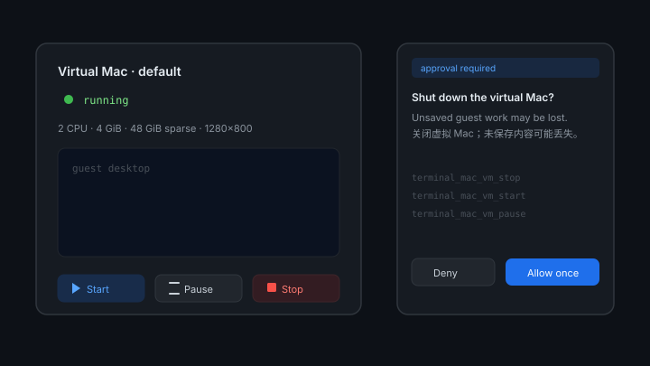

一个插件管起一台**独立于用户真实桌面的 macOS 虚拟机**：客户机里的鼠标键盘、虚拟机本身的开关，以及教 Agent 自己判断用不用、用完自己关的 skill。

宿主与客户机只共享一个 JSON 控制邮箱和一份只读工具目录；你的鼠标、剪贴板、麦克风、摄像头、主目录一概不共享。

## 前置条件

1. 已安装 terminal-mac：`~/.local/bin/terminal-mac`（`doctor` 报 `virtualizationSupported: true`）。
2. 虚拟机已创建：`terminal-mac up`（一次性，要下载 macOS 镜像并人工设置）。
3. 客户机内已装 `TerminalMacGuest.app` 并授予**屏幕录制**与**辅助功能**，且开启**自动登录**（否则每次启动都要人工登录）。

## 一、客户机操作工具（MCP）

工具名以 `mcp__terminal-mac__` 开头：

| 工具 | 作用 |
|---|---|
| `screenshot` | 截取客户机画面，返回 JPEG 与像素尺寸 |
| `click` | 坐标点击，`clicks: 2/3` 双击三击，`button: "right"` 右键 |
| `move` | 移动指针，触发悬停菜单 |
| `drag` | 按下拖拽到目标点 |
| `scroll` | 滚动，负 `dy` 向下 |
| `type` | 输入字面文本（Unicode 事件，不走剪贴板） |
| `key` | 按键或组合键：`return`、`tab`、`cmd+space`、`cmd+shift+4` |
| `status` | 客户机 helper 状态与两项权限 |

除 `screenshot`/`status` 外都接受 `screenshot: true`，动作后追加一张新截图。**坐标 = 最新截图的像素**，左上原点。

## 二、生命周期工具（原生）

| 工具 | 作用 | 审批 |
|---|---|---|
| `terminal_mac_vm_status` | 运行状态与进程号 | 不需要 |
| `terminal_mac_vm_start` | 启动（约 30–60 秒，自动登录） | 传 `confirm: true` 才审批 |
| `terminal_mac_vm_stop` | 关机并释放内存；`force: true` 直接断电、跳过客户机确认框 | 传 `confirm: true` 才审批 |
| `terminal_mac_vm_pause` | 暂停（内存不释放） | 传 `confirm: true` 才审批 |
| `terminal_mac_vm_resume` | 从暂停恢复 | 不需要 |

审批按调用：带 `confirm: true` 时在 `tools/pre-execute` 阶段返回 `ask`，走 DSH 审批通道；不带就直接执行。`requireConfirm: true` 可把默认改成一律询问。

会话审批策略为「从不询问」时 `ask` 会被**确定性拒绝**（fail closed），带 `confirm` 的调用会失败——该环境下应省略 `confirm`。

## 三、内嵌 skill

`skills/virtual-mac/SKILL.md` 在插件激活时通过 `ctx.skills.register()` 注册为 `virtual-mac`，模型技能目录里直接可见。它规定：

- 什么任务该自己启动虚拟机（GUI 操作、隔离需要），什么不该用（纯命令行、纯网页）
- 运行成本（约 4 GB 内存）与**任务结束自动关机**的判断顺序
- 观察 → 操作 → 验证 的流程与坐标规则
- 按任务决定是否带 `confirm`

## 配置

`cordis.patch.yml` 里有两条插件行：

**MCP 行**：

| 字段 | 值 | 说明 |
|---|---|---|
| `command` | `~/.local/bin/terminal-mac` | 启动器路径 |
| `args` | `['mcp', 'default']` | 第二项是虚拟机名 |
| `env.TERMINAL_MAC_HOME` | `~/Library/Application Support/terminal-mac` | 钉死数据目录 |
| `toolCallTimeoutMs` | 120000 | 单次操作超时 |

**本插件行**：

| 字段 | 默认 | 说明 |
|---|---|---|
| `launcher` / `machine` | `~/.local/bin/terminal-mac` / `default` | 同上的启动器与虚拟机名 |
| `requireConfirm` | `false` | `true` 时所有改状态调用都要求审批 |
| `startTimeoutMs` / `stopTimeoutMs` | 180000 | 启动、关机超时 |
| `pauseTimeoutMs` / `resumeTimeoutMs` / `statusTimeoutMs` | 30000 / 120000 / 30000 | 其余命令超时 |

## 验证

1. 插件列表只有一条「虚拟 Mac（terminal-mac）」并已启用。
2. 技能目录出现 `virtual-mac`。
3. `mcp__terminal-mac__status` 返回两项权限 `true`。
4. `terminal_mac_vm_status` 返回 `running` 或 `stopped`。
5. `mcp__terminal-mac__key { key: "cmd+space", screenshot: true }` → 截图里出现聚焦搜索。
6. `terminal_mac_vm_stop { force: true }` → 几秒内 `stopped`。

## 排错

| 现象 | 原因 | 处理 |
|---|---|---|
| `No virtual Mac named ...` | 还没建虚拟机 | `terminal-mac up`（需下载镜像 + 人工设置） |
| `VM 'default' is stopped` | 已关机 | `terminal_mac_vm_start` |
| `no logged-in session` | 停在登录界面或 helper 未运行 | 检查客户机自动登录与 helper |
| 权限 `false` | 屏幕录制/辅助功能失效 | 客户机内重新授权 |
| 关机 `command timed out` | 客户机弹了关机确认框 | 确认无未保存内容后 `stop { force: true }` |
| 带 `confirm` 被拒 | 审批策略为「从不询问」 | 省略 `confirm` |

## 限制

- `pause` 不释放内存；要省资源用 `stop`。
- 正常 `stop` 会请客户机自行关机，macOS 通常会弹「确定要现在将电脑关机吗？」；弹框期间 helper 不响应点击，所以那次调用可能先超时。确定没有未保存内容时用 `force`。
- 客户机默认能上网，**这不是网络隔离或抗恶意代码环境**。
- 不提供创建/克隆/回滚：建虚拟机与一次性授权仍需人工完成。
